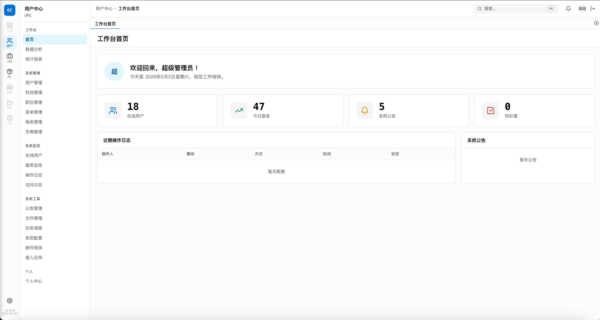
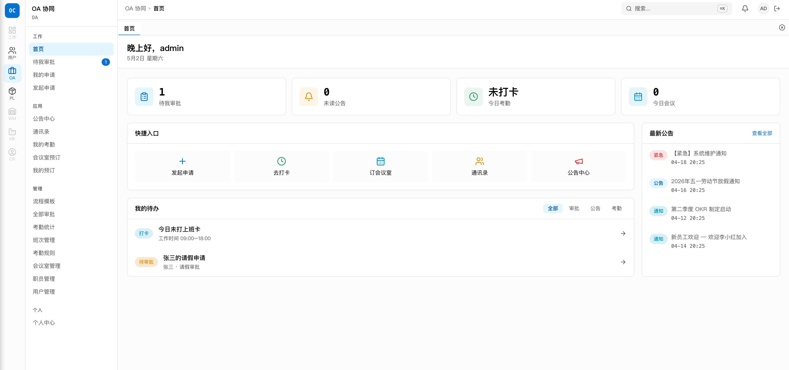
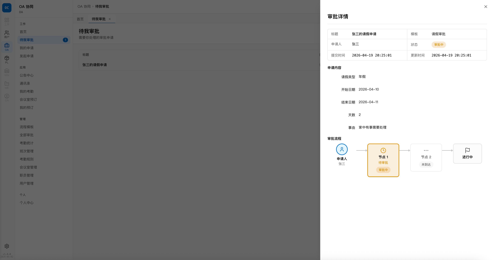
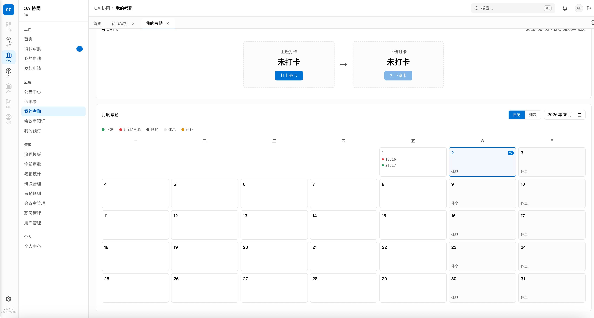
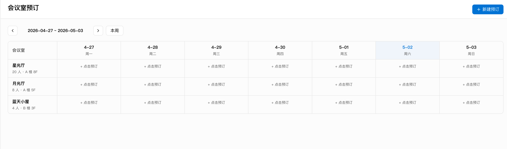
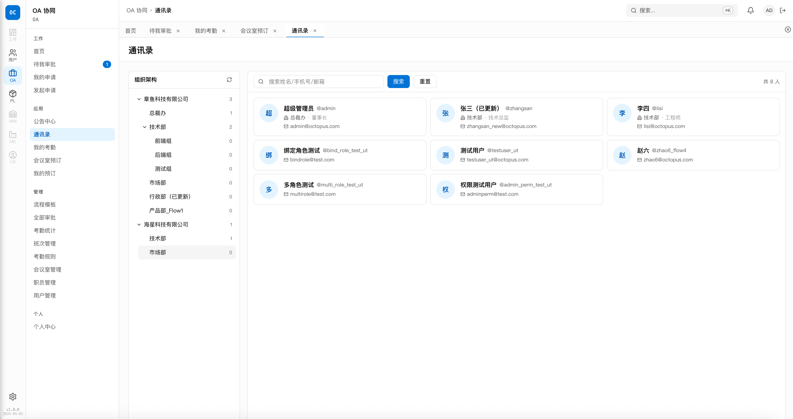
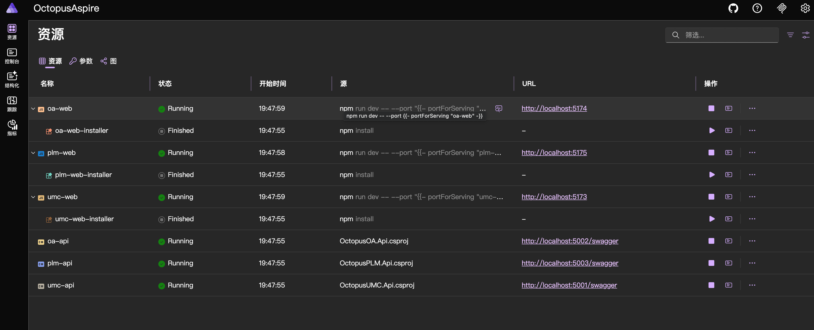
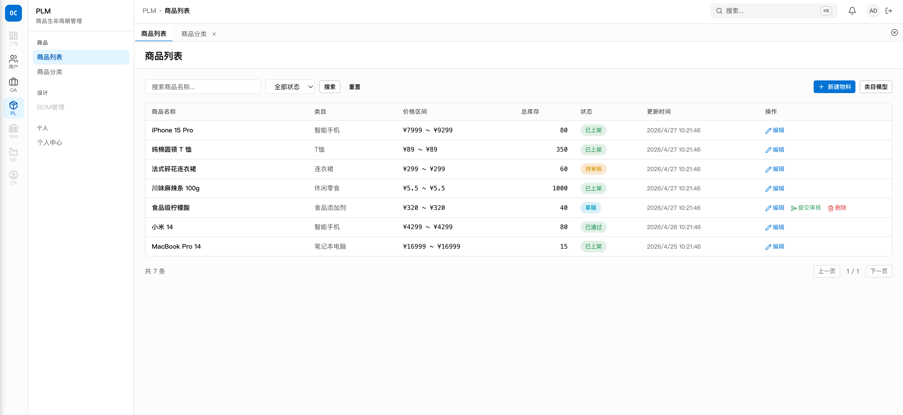
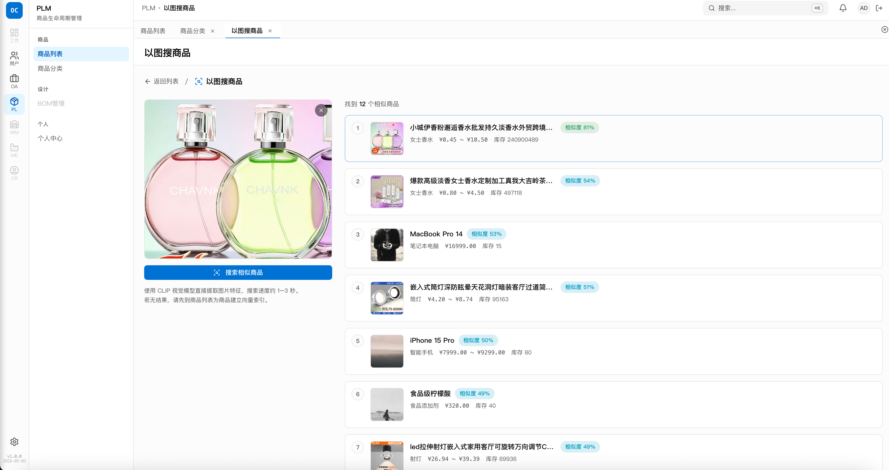

<div align="center">

# 🐙 Octopus ERP

**企业级多系统一体化平台 · 统一身份认证 · 办公自动化 · 商品生命周期管理**

[](https://claude.ai/code)
[](https://dotnet.microsoft.com)
[](https://vuejs.org)
[](https://github.com/openiddict/openiddict-core)
[](https://learn.microsoft.com/aspire)
[](#测试覆盖)
[](#持续集成)
[](LICENSE)

[快速开始](#快速开始) · [系统架构](#系统架构) · [功能特性](#功能特性) · [截图预览](#截图预览) · [开发指南](#开发指南)

</div>

---

## 项目简介

Octopus ERP 是一套面向中小企业的开源企业管理平台，采用**微服务 + SSO + 多租户**架构，目前包含 **10 个服务**：

| 系统 | 定位 | 端口 | 状态 |
|------|------|------|------|
| **OctopusUMC** | 统一用户中心（IdP）— 全平台身份认证、RBAC、组织、**唯一用户主数据源** | 5001 / 5173 | ✅ |
| **OctopusOA** | 办公自动化 — 审批流、考勤、会议室、公告、通讯录、职员 | 5002 / 5174 | ✅ |
| **OctopusPLM** | 商品生命周期 — 物料主数据、BOM、**以图搜商品**（CLIP 向量） | 5003 / 5175 | ✅ |
| **OctopusCRM** | 客户关系 — 客户、询盘、报价、合同、回款 | 5004 / 5176 | ✅ |
| **OctopusWMS** | 仓储 — 仓库、库存、出入库、盘点 | 5005 / 5177 | ✅ |
| **OctopusMES** | 生产执行 — 供应商、采购、工单、服装排产 | 5006 / 5178 | ✅ |
| **OctopusFIN** | 财务 — 复式记账、AR/AP、期间、银行 | 5007 | ✅ |
| **OctopusHRM** | 人力资源 — 员工、薪酬、绩效、假期 | 5008 | ✅ |
| **OctopusOMS** | 订单中台 — 多渠道电商订单 | 5009 | ✅ |
| **OctopusRetail** | **零售多租户** — 组织邀请、成员管理、workspace 切换 | 5010 / 5186 | ✅ |

平台内部统一走 **OpenIddict OIDC** 单点登录；**零售域例外**，它按设计使用 **Keycloak**
作为身份源（`https://localhost:8088`，realm `octopus`），见 [ADR-008](DECISIONS.md)。

---

## 🤖 由 Claude Code 构建

> 本项目（后端、前端、测试、文档）**100% 由 [Claude Code](https://claude.ai/code) 辅助完成**，是 AI 辅助编程在企业级项目中的完整实践案例。

### 什么让 AI 编程真正可用？—— Harness（驾驭框架）

单纯调用 AI 编写代码，会产生风格漂移、架构违反、重复解释同一约定的问题。本项目通过 **`.claude/` Harness** 解决了这些问题：

```
.claude/
├── rules/          ← 硬性约束（架构分层、TS strict、API 格式）Claude 每次会话都会遵守
├── commands/       ← 工作流菜单（/build /review /deploy /migrate）
├── agents/         ← 专用子 Agent（code-reviewer、security-auditor）
├── skills/         ← 条件触发知识（涉及部署时自动加载检查单）
└── settings.json   ← 工具权限矩阵（允许/禁止哪些 Bash 命令）

CLAUDE.md           ← 项目系统提示词（架构、规范、已知坑点）
```

**Harness 的核心价值**：

| 问题 | Harness 的解决方式 |
|------|-------------------|
| AI 忘记项目架构 | `CLAUDE.md` 每次会话自动加载，Claude 始终知道项目结构 |
| AI 生成不符合规范的代码 | `rules/` 中的约束是硬性的，不是建议 |
| 踩重复的坑 | `CLAUDE.md` "已知坑点"章节让 Claude 自动回避历史 Bug |
| 多步操作容易出错 | `commands/` 提供精确的操作步骤和成功标准 |
| PR 质量难以保证 | `agents/code-reviewer` 自动输出结构化审查报告 |

**653 个集成测试、10 个服务、OIDC SSO + 多租户、自定义审批引擎** — 全部在 Harness 约束下，由 Claude Code 辅助完成，无架构漂移。

> 📁 可复用的 Harness 模板在 [`harness-template/`](./harness-template) 目录，附完整使用说明。

---

## 截图预览

<table>
  <tr>
    <td align="center"><b>UMC · 用户管理</b></td>
    <td align="center"><b>OA · 工作台</b></td>
  </tr>
  <tr>
    <td></td>
    <td></td>
  </tr>
  <tr>
    <td align="center"><b>OA · 审批流程</b></td>
    <td align="center"><b>OA · 考勤日历</b></td>
  </tr>
  <tr>
    <td></td>
    <td></td>
  </tr>
  <tr>
    <td align="center"><b>OA · 会议室预订</b></td>
    <td align="center"><b>OA · 通讯录</b></td>
  </tr>
  <tr>
    <td></td>
    <td></td>
  </tr>
  <tr>
    <td align="center"><b>Aspire · 服务编排面板</b></td>
    <td align="center"><b>PLM · 商品管理</b></td>
  </tr>
  <tr>
    <td></td>
    <td></td>
  </tr>
  <tr>
    <td align="center" colspan="2"><b>PLM · 以图搜商品（CLIP 视觉向量搜索）</b></td>
  </tr>
  <tr>
    <td colspan="2" align="center"></td>
  </tr>
</table>

---

## 技术栈

### 后端

| 技术 | 版本 | 用途 |
|------|------|------|
| .NET | 10.0 | 运行时 |
| ASP.NET Core | 10.0 | Web 框架 |
| OpenIddict | 7.7 | OIDC/OAuth2 服务端（IdP） |
| EF Core | 10.0 | ORM |
| SQLite | — | 开发环境持久化 |
| MySQL | 8.0 | 生产环境数据库 |
| SignalR | — | 实时通信（公告推送、在线用户） |
| Serilog | 10.0 | 结构化日志 |
| xUnit | 2.x | 集成测试框架 |
| ONNX Runtime | 1.20.1 | CLIP 视觉模型推理（PLM 以图搜商品） |
| SixLabors.ImageSharp | 3.1.6 | 图像预处理（PLM 以图搜商品） |
| **Keycloak** | 26.x | **零售域身份源**（realm `octopus`，HTTPS :8088） |
| BCrypt.Net-Next | 4.2.1 | 密码哈希 |
| ASP.NET RateLimiter | 内置 | 登录 10 次/分钟、其余 100 次/分钟 |

### 前端

| 技术 | 版本 | 用途 |
|------|------|------|
| Vue | 3.5 | UI 框架（Composition API） |
| TypeScript | 5.9 | 强类型（strict 模式） |
| Vite | 8.x | 构建工具 |
| Tailwind CSS | 4.3 | 原子化 CSS |
| shadcn-vue | latest | Headless 组件库 |
| Pinia | 4.x | 状态管理 |
| oidc-client-ts | latest | OIDC 客户端（SSO） |
| @lucide/vue | 1.55 | 图标（已从 `lucide-vue-next` 迁移） |
| @tanstack/vue-table | 9.x | 高性能表格（v9 API） |

### 基础设施

| 技术 | 用途 |
|------|------|
| .NET Aspire 13.x | 一键启动编排 + 可观测性 Dashboard（:15256） |
| Docker Compose | 容器化部署（Keycloak + PostgreSQL） |
| Qdrant | 向量数据库（PLM 以图搜商品，gRPC :6334） |
| PostgreSQL 17 | Keycloak 的持久化存储（容器内） |

---

## 系统架构

```
                       ┌───────────────────────────────────────────┐
                       │              浏览器（7 个前端）              │
                       │ UMC 5173 │ OA 5174 │ PLM 5175 │ CRM 5176   │
                       │ WMS 5177 │ MES 5178 │ Retail 5186           │
                       └───────┬────────────────────┬──────────────┘
                               │ OIDC 授权码 + PKCE  │ OIDC（Keycloak）
                               ▼                    ▼
        ┌──────────────────────────────┐   ┌──────────────────────────┐
        │  OctopusUMC  :5001（IdP）      │   │  Keycloak :8088（HTTPS）  │
        │  OpenIddict · RBAC · 组织      │   │  realm: octopus          │
        │  ★ 全平台唯一用户主数据源        │   │  groups / depts / 租户组  │
        └───────┬──────────────────────┘   └────────────┬─────────────┘
                │ JWT Bearer                            │ JWT
    ┌───────────┼───────────┬───────────┬───────────┐  │
    ▼           ▼           ▼           ▼           ▼  ▼
 ┌──────┐   ┌──────┐   ┌──────┐   ┌──────┐   ┌──────┐ ┌──────────┐
 │  OA  │   │ PLM  │   │ CRM  │   │ WMS  │   │ MES  │ │  Retail  │
 │ :5002│   │ :5003│   │ :5004│   │ :5005│   │ :5006│ │   :5010  │
 └──────┘   └───┬──┘   └──────┘   └──────┘   └──────┘ └────┬─────┘
                │ Qdrant :6333/6334                        │ tenant_id
                ▼（CLIP 512 维向量）                  （租户隔离只在零售库）
 ┌──────┐   ┌──────┐   ┌──────┐                  ┌──────────────┐
 │ FIN  │   │ HRM  │   │ OMS  │                  │ retail_tenant│
 │ :5007│   │ :5008│   │ :5009│                  │ retail_member│
 └──────┘   └──────┘   └──────┘                  └──────────────┘

              Aspire Dashboard :15256（编排 + 监控 + 日志聚合）
```

**两条身份链路**（关键设计，见 [ADR-008](DECISIONS.md) / [ADR-010](DECISIONS.md)）：

| 域 | 身份源 | 用户主数据 | 租户隔离 |
|---|---|---|---|
| 平台九个子系统 | UMC（OpenIddict） | `UMC.sys_user` | 无（单租户） |
| 零售域 | Keycloak | **仍然登记进 UMC** | `retail_db` 内 `tenant_id` |

> 零售用户虽然由 UMC 统一建号与管理，但**租户归属只存在于零售库**——
> UMC 业务表不加 `tenant_id`，避免污染九个下游子系统。

### 单点登录流程

```
用户访问 OA/PLM/CRM/WMS/MES
  → oidc-client-ts 发起授权请求（PKCE）
  → 重定向到 UMC 登录页
  → 用户登录（Cookie 会话）
  → OpenIddict 颁发授权码 → 换取 access_token
  → 访问各子系统 API（Bearer Token）
  → UMC Back-Channel Logout 同步注销
```

零售域走独立的 Keycloak 链路，并在 token 的 `groups` 声明里携带
`/tenants/{tenantId}`；前端切换 workspace 时通过 `X-Tenant-Id` 头传递
当前租户，服务端用 token 校验（见 [ADR-009](DECISIONS.md)）。

---

## 功能特性

### OctopusUMC · 统一用户中心

- **OIDC 身份提供商**：授权码流 + PKCE、刷新令牌、客户端凭据流
- **用户管理**：用户 CRUD、启用/禁用、重置密码、批量操作
- **组织架构**：多公司 + 多层级部门树、跨公司兼职支持
- **RBAC 权限**：角色管理、菜单权限树、五种数据权限范围
- **SSO 单点登出**：Back-Channel Logout 联动注销所有子系统
- **用户同步 Webhook**：HMAC-SHA256 签名，推送用户变更到子系统

### OctopusOA · 办公自动化

- **可定制审批流引擎**
  - 动态表单（支持文本/数字/日期/下拉/多行文本）
  - 灵活审批人配置（指定角色/用户/部门主管/自选）
  - 完整状态机（草稿 → 审批中 → 通过/驳回/撤回）
  - 审批流程图可视化（纯 CSS 节点图）
  - 内置模板：请假审批、报销审批、补卡审批

- **考勤管理**
  - 多班次配置（标准班/早班/晚班/弹性班）
  - 月度考勤日历视图 + 列表视图
  - 上下班打卡（IP 白名单控制）
  - 异常统计（迟到/早退/缺卡）
  - 补卡审批联动（审批通过自动更新考勤记录）

- **会议室预订**
  - 周视图日历（会议室 × 7 天矩阵）
  - 实时冲突检测（同房间时段重叠返回 409）
  - 我的预订管理

- **公告中心**：分级公告（通知/公告/紧急）、已读追踪、未读徽标

- **通讯录**：部门树 + 用户卡片 + 详情抽屉（含跨公司任职信息）

- **职员管理**（入职流程）
  - HR 创建临时档案 → 生成 H5 入职链接
  - 候选人自助填写（六模块：个人信息/教育/工作/家庭/紧急联系人/银行卡）
  - HR 审核 → 确认入职（自动创建 UMC 账号）
  - 五状态流转：临时 → 待入职 → 在职/拒绝/离职

- **工作台**：数据看板（待审批/未读公告/今日考勤/今日会议）+ 聚合待办

### OctopusPLM · 商品生命周期管理

- **商品管理**：商品主数据 CRUD、分类管理、规格/价格/库存、上架/下架/停产状态流转
- **以图搜商品**（CLIP 视觉向量搜索）
  - 上传任意图片，AI 直接返回最相似商品列表（约 0.2–1 秒）
  - 技术路线：`SixLabors.ImageSharp` 图像预处理 → `CLIP ViT-B/32 ONNX` 推理 → `Qdrant` 向量最近邻搜索
  - 纯 .NET 推理，无需 Python / Ollama，Apple Silicon 自动启用 CoreML Neural Engine 加速
  - 相似度可视化（绿 ≥ 60% / 蓝 ≥ 35% / 黄 < 35%）
  - 支持拖拽上传，结果可直接跳转商品编辑页
  - 批量/单品向量化 API，索引增量可控

### OctopusCRM · 客户关系管理

- **客户管理**：客户档案 + 联系人、等级/状态、关键词检索
- **销售链路**：询盘 → 报价 → 合同 → 回款，状态机驱动
- **审批联动**：报价/合同/大额回款提交 OA 审批（HMAC 回调）
- **Webhook**：合同激活触发 WMS 库存预占；WMS 发货回调更新合同状态

### OctopusWMS · 仓储管理

- **仓库与库位**、库存查询、低库存预警、手动调整
- **出入库**：入库收货、出库发货自动增减库存；盘点任务与差异处理
- **跨系统**：接收 CRM 合同预占、MES 完工入库；出库发货回调 CRM

### OctopusMES · 生产执行与采购

- **供应商 / 采购订单 / 工单**：审批、开工、完工、工序进度
- **服装排产**：班组、排产看板、按日产能分配（含外协组）
- **跨系统**：工单完工 → WMS 入库

### OctopusFIN · 财务

- 复式记账、会计科目、凭证、应收/应付、期间关账、银行账户与期初余额
- HRM 薪酬单确认后自动生成薪资凭证

### OctopusHRM · 人力资源

- 员工档案、薪资项与薪资单计算、假期、KPI
- 与 FIN 联动生成凭证

### OctopusOMS · 订单中台

- 多渠道接入（淘宝/京东/拼多多/抖音/Shopify/Amazon）、店铺、订单与明细
- SKU 映射到 PLM 商品、售后单

### OctopusRetail · 零售多租户（独立身份域）

- **组织（租户）**：门店 / 连锁总部 / 加盟店 / 企业 / 子公司，支持上下级
- **邀请入店**：短码链接 `/i/{code}` 或手动输码 `/join`；注册方式两种
  （匿名自助注册建号，或已有账号直接加入）
- **workspace 切换**：一个账号可属于多个组织，切换后所有请求带 `X-Tenant-Id`
- **成员管理**：停用/启用（同步禁用 Keycloak 账号）、移出、重置密码；含
  不可越级、不可移除最后一个所有者等约束
- **租户隔离**：EF Core fail-closed 全局过滤器 + 启动期 `TenantFilterGuard` 校验

---

## 快速开始

### 环境要求

- [.NET 10 SDK](https://dotnet.microsoft.com/download/dotnet/10.0)
- [Node.js 20+](https://nodejs.org)
- [npm 10+](https://www.npmjs.com)
- [Docker](https://www.docker.com)（PLM 以图搜商品需要，用于运行 Qdrant 向量数据库）

### PLM 以图搜商品：额外准备

使用 PLM 的以图搜商品功能前，需完成以下两步：

**1. 下载 CLIP ONNX 模型**（约 59 MB，仅需一次）

```bash
# 国际网络
bash OctopusPLM/scripts/download-models.sh

# 国内网络（使用 hf-mirror.com 镜像）
bash OctopusPLM/scripts/download-models.sh --mirror
```

**2. 启动 Qdrant 向量数据库**

```bash
docker run -d --name qdrant --restart unless-stopped \
  -p 6333:6333 -p 6334:6334 \
  -v "$(pwd)/qdrant_data:/qdrant/storage" \
  qdrant/qdrant:latest
```

> 详细说明见 [`OctopusPLM/README.md`](./OctopusPLM/README.md)

### 一键启动（推荐）

使用 **.NET Aspire** 一键启动所有服务：

```bash
git clone https://github.com/Fat-Snail/OctopusERP.git
cd OctopusERP

# 一次性安装全部前端依赖（7 个）
for d in Octopus*/web/Octopus*; do (cd "$d" && npm ci); done

# 启动 Aspire（自动编排全部服务 + Keycloak 容器）
cd aspire/OctopusAspire.AppHost && dotnet run
```

仓库根目录的 `restart.sh` 封装了"清理端口 → 启动 Aspire"的常用流程：

```bash
bash restart.sh              # 常规重启
bash restart.sh --reset-kc   # 重建 Keycloak realm（改过 octopus-realm.json 时用）
```

启动后访问：

| 服务 | 地址 | 说明 |
|------|------|------|
| Aspire Dashboard | http://localhost:15256 | 编排、日志、指标（登录令牌每次重启都会变） |
| UMC 管理后台 | http://localhost:5173 | 统一用户中心 |
| OA / PLM / CRM | http://localhost:5174-5176 | |
| WMS / MES | http://localhost:5177-5178 | |
| **Retail** | http://localhost:5186 | 零售多租户 |
| **Keycloak** | **https://localhost:8088** | 零售域身份源（HTTP 打不通，必须 HTTPS） |
| 后端 API | http://localhost:5001-5010 | 每个系统一个端口 |

### 默认账号

| 系统 | 账号 | 密码 | 角色 |
|------|------|------|------|
| UMC / OA / PLM 等 | `admin` | `Admin@123` | 超级管理员 |
| UMC | `zhangsan` / `lisi` / `editor` | `Admin@123` | 普通员工（zhangsan 跨公司兼职） |
| 零售域（Keycloak） | 同上任一账号 | `Admin@123` | 见各组织的成员角色 |

> **开发环境统一密码**：`Admin@123`。种子数据里 `wangwu` 为**禁用**状态（登录返回 403）。
> 两套密码体系（UMC 的 BCrypt 与 Keycloak 凭据）不会自动同步，统一由脚本或
> 「重置密码」接口维护，详见下方「安全与合规」。
>
> 数据库统一位于仓库根的 `data/` 目录（`*.db` 不入库）。删除对应 `.db` 后重启即可
> 回到干净种子；**只有空库才会重新播种**。

零售域演示组织：`上海南京路店`（store）、`成都春熙路店`（store）、
`华东销售子公司`（subsidiary）、`连锁总部`（chain）。

### 独立启动（各服务分开运行）

```bash
# UMC 后端
cd OctopusUMC/src/OctopusUMC.Api && dotnet run

# UMC 前端
cd OctopusUMC/web/OctopusUMC.Web && npm run dev

# OA 后端
cd OctopusOA/src/OctopusOA.Api && dotnet run

# OA 前端
cd OctopusOA/web/OctopusOA.Web && npm run dev
```

---

## 测试覆盖

采用 **TDD**，全部为**集成测试**（真实 SQLite 内存库，不 mock 数据库）：

| 项目 | 测试数 | 覆盖重点 |
|------|-------:|---------|
| OctopusUMC.Api.Tests | 166 | 登录/OIDC/角色/菜单/数据权限/多公司/**用户主数据(ADR-010)**/密码安全 |
| OctopusRetail.Api.Tests | 116 | 租户隔离/邀请注册/短码/成员管理/资料回传 |
| OctopusMES.Api.Tests | 117 | 供应商/采购/工单/排产/**数据迁移与脱敏** |
| OctopusOA.Api.Tests | 100 | 审批流/考勤/会议/公告/通讯录/职员 |
| OctopusWMS.Api.Tests | 41 | 仓库/库存/出入库/盘点/Webhook |
| OctopusCRM.Api.Tests | 38 | 客户/询盘/报价/合同/回款 |
| OctopusPLM.Api.Tests | 35 | 商品/类目/BOM/审核流/向量检索 |
| OctopusFIN.Api.Tests | 19 | 凭证/应收应付/期间/期初 |
| OctopusHRM.Api.Tests | 11 | 薪资/假期/KPI |
| OctopusOMS.Api.Tests | 10 | 渠道/订单/售后 |
| **合计** | **653** | |

```bash
# 单系统
cd OctopusUMC && dotnet test

# 全部后端（约 2 分钟）
for p in OctopusUMC OctopusRetail OctopusMES OctopusOA OctopusWMS \
         OctopusCRM OctopusPLM OctopusFIN OctopusHRM OctopusOMS; do
  ( cd $p && dotnet test --nologo ) || echo "❌ $p"
done

# 前端类型检查（与 CI 完全一致）
for d in Octopus*/web/Octopus*; do ( cd "$d" && npx tsc --noEmit && npm run build ); done
```

---

## 持续集成

`.github/workflows/ci.yml` 三组任务，**推送到 `master`/`main` 或提 PR 时触发**：

| 任务 | 覆盖 |
|------|------|
| `backend` | 10 个后端的 `dotnet test` |
| `frontend` | 7 个前端的 `npx tsc --noEmit` + `npm run build` |
| `docker-lint` | `docker compose config --quiet` |

> ⚠️ 前端类型检查依赖根 `tsconfig.json` **真的包含源码**。历史上 UMC/OA/CRM/WMS/MES
> 用的是 `{ "files": [], "references": [...] }`，裸 `tsc` 一个文件都不编译、
> 永远通过——CI 类型检查是空转。现已改为继承 `tsconfig.app.json` 并显式声明
> `include`，同时补了 `src/shims-vue.d.ts`（`vue-tsc` 认识 `.vue`，裸 `tsc` 不认识）。

---

## 项目结构

```
OctopusERP/
├── OctopusUMC/          # 统一用户中心（IdP，唯一用户主数据源）
├── OctopusOA/           # 办公自动化
├── OctopusPLM/          # 商品生命周期（含 CLIP 向量检索）
├── OctopusCRM/          # 客户关系
├── OctopusWMS/          # 仓储
├── OctopusMES/          # 生产执行 / 服装排产
├── OctopusFIN/          # 财务
├── OctopusHRM/          # 人力资源
├── OctopusOMS/          # 订单中台
├── OctopusRetail/       # 零售多租户（独立 Keycloak 身份域）
├── OctopusCommon/       # 共享库：数据迁移执行器、内部接口密钥策略
├── aspire/              # .NET Aspire 编排（AppHost + Keycloak realm）
├── design/              # 设计文档（零售多租户、排产等）
├── docs/
│   ├── acceptance/      # 验收清单
│   └── superpowers/     # 方案与规格
├── scripts/             # 运维脚本（Keycloak 密码/脱敏）
├── data/                # 本地 SQLite（git 忽略）
├── DECISIONS.md         # 架构决策记录 ADR-001 ~ ADR-011
├── CLAUDE.md            # AI 协作指南 + 已知坑点速查
├── README.md            # 本文件
└── restart.sh           # 一键重启（清理端口 + 启动 Aspire）
```

每个子系统的内部结构保持一致：

```
OctopusXXX/
├── src/OctopusXXX.Api/
│   ├── Controllers/          # HTTP 编排层
│   ├── Services/             # 业务服务（Scoped）
│   └── Persistence/          # EF Core 实体 / DbContext / Seeder
│       └── Migrations/       # 数据订正脚本（*.sql，嵌入程序集）
├── tests/OctopusXXX.Api.Tests/
└── web/OctopusXXX.Web/       # Vue 3 + Vite + TS strict
```

---

## 数据库说明

开发环境使用 SQLite 文件数据库（统一放在仓库根的 `data/`，已 git 忽略），
生产切换到 MySQL 只需替换 Provider：

```csharp
// 开发（默认）
opt.UseSqlite(connectionString);

// 生产
opt.UseMySql(connectionString, ServerVersion.AutoDetect(connectionString));
```

### 三层保护：Schema 自愈 / 数据迁移 / 幂等种子

这几个子系统都用 `EnsureCreated()` + 幂等 Seeder、**没有 EF Migrations**，
`EnsureCreated` 只在库文件不存在时建表，因此老库不会自动补表/补列。为此有三层机制：

| 机制 | 位置 | 作用 |
|---|---|---|
| **Schema 自愈** | `SchemaUpgrader`（UMC） | 补缺失的表/列，列带模型默认值并回填历史 NULL |
| **数据迁移** | `OctopusCommon/Persistence/DataMigrationRunner` | 存量数据订正，执行一次并记录到 `*_data_migration` |
| **幂等 Seeder** | 各 `*DbSeeder` | 仅空库播种 |

数据迁移的约定（踩过的坑都写在代码注释里）：

```csharp
// 脚本放在 Persistence/Migrations/*.sql，作为 EmbeddedResource 编译进程序集
// 文件名即迁移 Id，执行后写入 mes_data_migration / sys_data_migration / crm_… / wms_…
MesDataMigrationRunner.Apply(db, logger, throwOnError: false);
```

> ⚠️ 迁移脚本必须**幂等**，且尽量**只按主键/自增列定位**——不要把待清除的敏感原值
> 写进 SQL，否则清理工具本身就成了泄露源。
>
> ⚠️ 不要用 `ExecuteSqlRaw` 执行脚本：它会无条件把 SQL 交给 `string.Format`，
> 注释里出现 `{Foo}` 就会抛 `FormatException` 且被吞掉，表现为"迁移什么都没做"。
> 共享库已改用原始 ADO。

---

## 多租户与统一用户模型

零售域与平台其它系统采用**不同的身份链路**，但用户主数据是统一的：

```
零售邀请注册 ──▶ UMC /api/internal/users/retail ──▶ sys_user(user_type=customer)
                            │                               │
                            └── 同步 ──▶ Keycloak ◀─────────┘（回写 kc_sub）

零售域只写成员关系：retail_membership(kc_sub, tenant_id, role)
```

| 概念 | 存放位置 | 说明 |
|---|---|---|
| **用户** | `UMC.sys_user` | 唯一主数据源；`user_type` = employee / customer |
| **租户** | `retail_tenant` | 门店 / 连锁总部 / 加盟店 / 企业 / 子公司 |
| **成员关系** | `retail_membership` | 用户在某个租户中的角色 |
| **当前租户** | 请求头 `X-Tenant-Id` | 由前端 workspace 切换，服务端用 token 校验 |

**为什么零售用户也要进 UMC**：早期规划把零售用户挡在 UMC 之外，结果运营在
`5173/system/users` 里查不到能登录的人、也无法停用或改密，只能去 Keycloak 控制台。
现已改为"所有用户统一在 UMC 管理"，同时用 `user_type` 保证**客户不会进入 OA 通讯录**
等下游系统（`UserSyncService` 只推 `employee`）。详见
[ADR-010](DECISIONS.md)。

---

## 安全与合规

| 主题 | 措施 |
|---|---|
| **内部接口密钥** | UMC ⇄ 零售的 `/api/internal/*` 用 `X-Internal-Secret` + 恒定时间比较；**配置缺失时 fail-closed**（仅 Development/Test 回退开发密钥，其它环境拒绝请求） |
| **密码存储** | BCrypt；重置密码强制 ≥ 8 位（此前空字符串会被哈希入库并允许空密码登录，已修） |
| **登录限流** | 登录接口 10 次/分钟/IP，其余 100 次/分钟 |
| **种子数据脱敏** | 早期种子含真实员工姓名、一个**校验位合法**的身份证号、真实企业名/税号、真实客户与排产数据；现已全部替换为占位值，并通过数据迁移订正存量库 |
| **租户隔离** | EF Core fail-closed 全局过滤器（未解析租户时匹配空集）+ `TenantFilterGuard` 启动期校验 |

一键把开发库里 Keycloak 的密码统一（仅本地）：

```bash
bash scripts/dev-reset-keycloak-passwords.sh            # 默认 Admin@123
bash scripts/dev-anonymize-keycloak-users.sh            # 把历史真实账号改名
```

> **注意**：仓库的**提交历史**中仍可能残留早期种子里的敏感数据。如需彻底清理，
> 需重写历史（`git filter-repo`），当前 `main` 的文件树已是干净的。

---

## 部署

### Docker Compose

```bash
docker compose up -d
```

### 生产环境配置

```bash
# 设置环境变量
export ConnectionStrings__OaDb="Server=...;Database=octopus_oa;..."
export ConnectionStrings__UmcDb="Server=...;Database=octopus_umc;..."
export OpenIddict__EncryptionKey="..."
export Webhooks__SharedSecret="..."
```

---

## 开发指南

### 代码规范

- 后端：整洁架构（Api → Infrastructure → Core），Controller ≤ 10 行
- 前端：TypeScript `strict` 模式，禁止 `any`，类型与后端 DTO 一一镜像
- 所有接口统一响应格式：`{ code, msg, data }`

### 新增功能流程（六步闸门制）

```
Step 1 前端样板 → Step 2 后端骨架 → Step 3 接口确认
                                            ↓
Step 6 功能验收 ← Step 5 SSO打通 ← Step 4 前后端联调
```

### 本地开发注意事项

- 修改种子数据后删除对应 `.db` 文件重启即可重建（**只有空库才会重新播种**）
- 前端类型检查务必与 CI 一致：`npx tsc --noEmit && npm run build`
  - 若突然出现大量 `TS2307 Cannot find module './App.vue'`，先 `rm -rf node_modules/.tmp`
    （陈旧的 `tsbuildinfo` 会报幽灵错误）
- 全量测试：`dotnet test`（各子系统目录下执行）
- **改动 `.gitignore` 时注意**：`build/`、`contract/` 这类通用规则会误伤
  `OctopusPLM/web/**/build/`、`OctopusCRM/web/**/src/views/contract/`，
  已锚定为 `/build/`、`/contract/`

---

## 路线图

- [x] UMC：OIDC 身份提供商 + SSO
- [x] UMC：RBAC 权限体系（菜单/角色/数据权限）
- [x] UMC：用户/部门/职位/字典管理
- [x] OA：可定制审批流引擎
- [x] OA：考勤管理（多班次 + 补卡联动）
- [x] OA：会议室预订（冲突检测 + 日历视图）
- [x] OA：公告中心 + 通讯录
- [x] OA：职员入职管理
- [x] OA：工作台聚合待办
- [x] Aspire 一键编排
- [x] PLM：商品管理（主数据 CRUD + 状态流转）
- [x] PLM：以图搜商品（CLIP ONNX 视觉向量搜索）
- [x] CRM / WMS / MES / FIN / HRM / OMS 六个子系统
- [x] Retail：零售多租户（邀请注册、短码链接、成员管理、workspace 切换）
- [x] UMC 成为全平台唯一用户主数据源（ADR-010）
- [x] 数据迁移机制 + 种子数据脱敏（ADR-011）
- [x] CI：10 个后端 + 7 个前端全量校验
- [x] 内部接口 fail-closed 密钥策略
- [ ] UMC：在线用户（SignalR）
- [ ] UMC：操作日志 + 访问日志
- [ ] UMC：文件管理（OSS 策略模式）
- [ ] 零售：短信/企微触达邀请、邀请码限流
- [ ] 移动端适配

---

## 架构决策记录（ADR）

重要设计取舍都记录在 [DECISIONS.md](DECISIONS.md)，按时间编号：

| ADR | 主题 |
|---|---|
| ADR-004 | H5 移动端独立 Vite 项目，不共享桌面端代码 |
| ADR-005 | 跨系统 Webhook 用直接 HTTP，而非消息队列 |
| ADR-006 | OA SLO 催办用 `BackgroundService` 轮询 |
| ADR-007 | SQLite Schema 模型驱动自愈（替代 EF Migrations） |
| **ADR-008** | 零售走「独立服务 + `tenant_id` 只落零售库」，不把多租户侵入 UMC |
| **ADR-009** | 一人多租户的身份切换 = token 携带租户全集 + `X-Tenant-Id` 服务端校验 |
| **ADR-010** | **UMC 是唯一用户主数据源**（修正 ADR-008 中"零售用户不进 UMC"的错误部分） |
| **ADR-011** | 存量真实姓名匿名化 + 轻量数据迁移机制 |

> ADR-010 是一次公开的自我纠错：ADR-008 为了"不污染 9 个下游子系统"而把零售用户
> 挡在 UMC 之外，结果与 UMC「统一用户中心」的定位冲突——运营查不到能登录的人。
> 现在改为"所有用户统一进 UMC + 下游只同步 `employee`"，两个目标同时满足。

---

## 文档索引

| 文档 | 内容 |
|---|---|
| [README.md](README.md) | 本文件：快速开始、架构、测试、安全 |
| [CLAUDE.md](CLAUDE.md) | AI 协作指南：架构约定、端口表、**已知坑点速查**（Aspire/Keycloak/EF 等） |
| [DECISIONS.md](DECISIONS.md) | 架构决策记录 ADR-001 ~ ADR-011 |
| [design/](design/) | 设计方案：零售多租户（含实现日志与缺陷记录）、离散制造排产 |
| [docs/acceptance/](docs/acceptance/) | 验收清单（零售多租户邀请流程） |
| [docs/superpowers/](docs/superpowers/) | 阶段性方案与规格 |
| [ROADMAP.md](ROADMAP.md) · [TODO.md](TODO.md) | 路线图与待办 |
| [MINIAPP-PLATFORM.md](MINIAPP-PLATFORM.md) | 小程序平台设计（多 realm 取舍等） |

---

## 贡献指南

欢迎提交 Issue 和 Pull Request！

1. Fork 本仓库
2. 创建功能分支：`git checkout -b feature/your-feature`
3. 提交前确保 `dotnet test` 全部通过、`npx tsc --noEmit` 无报错
4. 提交 PR，描述改动原因和测试方式

---

## License

[MIT](LICENSE)

---

<div align="center">
  <sub>
    Built with <a href="https://claude.ai/code">Claude Code</a> · 
    Powered by .NET 10 + Vue 3 + OpenIddict · 
    AI-assisted development guided by <a href="./harness-template">Claude Code Harness</a>
  </sub>
</div>
